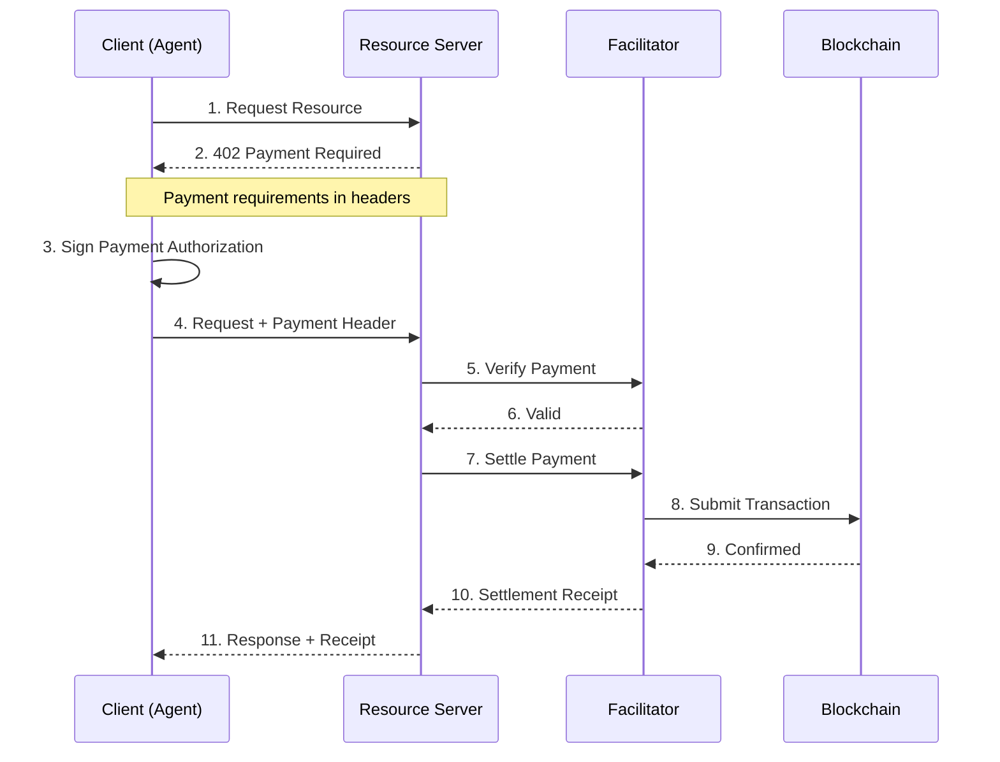

x402 is an open protocol for internet-native payments that activates the HTTP 402 "Payment Required" status code. It enables AI agents and applications to make instant, permissionless micropayments using stablecoins.

## Key Features

- **HTTP-Native**: Built into existing HTTP requests with no additional communication required
- **Instant Settlement**: Sub-second on Celo, compared to days with traditional payments
- **Zero Protocol Fees**: Only pay nominal blockchain gas fees
- **Agent-First**: Designed for autonomous AI agent transactions
- **Chain Agnostic**: Supports 170+ [EVM](https://ethereum.org/developers/docs/evm/) chains including Celo

## Why x402?

Traditional payment systems don't work for AI agents and micropayments:

| Challenge | Traditional Payments | x402 |
|-----------|---------------------|------|
| Setup Time | Days to weeks | Minutes |
| Settlement | 2-7 days | Sub-second on Celo |
| Fees | 2-3% + $0.30 fixed | ~$0.001 gas |
| Minimum Payment | $0.50+ | $0.001 |
| Account Required | Yes | No |
| API Keys | Required | Not needed |
| Chargebacks | Yes (120 days) | No |
| AI Agent Support | Not possible | Native |

## How It Works

A *facilitator* is a service that checks a buyer's signed payment and submits it on-chain on the seller's behalf, so the seller does not run a node or need CELO for gas.



**Step-by-step:**

1. **Client requests resource** - AI agent or app sends HTTP request to API
2. **Server returns 402** - If no payment attached, server responds with `HTTP 402 Payment Required` and payment details in headers
3. **Client signs payment** - Client signs payment authorization using their wallet
4. **Client retries with payment** - Request sent again with a `PAYMENT-SIGNATURE` header
5. **Server verifies and settles** - Payment is verified and settled on-chain
6. **Server delivers resource** - Requested content returned with payment receipt

## Get Started with the Celo Facilitator

Celo runs its own hosted x402 facilitator, built on the open-source [`x402-rs`](https://github.com/x402-rs/x402-rs) implementation. It is the recommended default for accepting x402 payments on Celo. It settles 10 stablecoins on Celo. The six Ripio wFIAT local-currency stablecoins and **cNGN** settle through Permit2. **USDC**, **USD₮** and **USA₮**, the US Dollar-backed stablecoin issued by Anchorage Digital Bank, N.A., and supported by Tether, settle through the gasless [EIP-3009](https://eips.ethereum.org/EIPS/eip-3009) `transferWithAuthorization` scheme. With EIP-3009 the buyer signs an authorization off-chain, and the facilitator submits it on-chain and pays the gas itself. The facilitator never custodies funds: `transferWithAuthorization` moves tokens directly payer → payee inside the token contract.

Two hosts are involved, and they are not interchangeable:

- **Dashboard** — [x402.celo.org](https://x402.celo.org/) serves the web dashboard (a single-page app). Do not point a resource server at it.
- **Payment API** — `https://api.x402.celo.org` (mainnet) is the facilitator endpoint your resource server talks to for `/verify`, `/settle`, and `/supported`. Celo Sepolia is at `https://api.x402.sepolia.celo.org`.

<Note>
  The endpoints below are live at `https://api.x402.celo.org` (mainnet) and `https://api.x402.sepolia.celo.org` (Celo Sepolia).
</Note>

### Endpoints

Base URLs:

- **Mainnet** — `https://api.x402.celo.org`
- **Celo Sepolia** — `https://api.x402.sepolia.celo.org`

| Method | Path         | Auth        | Purpose                                                           |
|--------|--------------|-------------|--------------------------------------------------------------------|
| `POST` | `/verify`    | Open        | Off-chain signature and simulation check of a payment payload.     |
| `POST` | `/settle`    | **API key** | Submit the buyer's authorization on-chain (facilitator pays gas).  |
| `GET`  | `/supported` | Open        | List supported `(network, scheme)` pairs.                          |
| `GET`  | `/health`    | Open        | Liveness probe.                                                    |

Only `/settle` requires an API key — so `/verify` and `/supported` succeed and an integration looks healthy right up until its first settlement, which fails with `401` if no key is attached. See [Getting an API Key](#getting-an-api-key).


### Pointing a Resource Server at It

The x402 v2 middleware wires a resource server to the Celo facilitator. Install the scoped packages:

```bash
npm i @x402/express @x402/core @x402/evm
```

```ts
import express from "express";
import { paymentMiddleware, x402ResourceServer } from "@x402/express";
import { HTTPFacilitatorClient, type RoutesConfig } from "@x402/core/server";
import { ExactEvmScheme } from "@x402/evm/exact/server";

// Celo's hosted facilitator — note the api. subdomain
const facilitator = new HTTPFacilitatorClient({
  url: "https://api.x402.celo.org",
  // Attaches your metering key to every facilitator request. /settle is
  // key-gated; without a valid key it returns 401 Missing X-API-Key.
  createAuthHeaders: async () => {
    const h = { "X-API-Key": process.env.X402_API_KEY! };
    return { verify: h, settle: h, supported: h };
  },
});

const server = new x402ResourceServer(facilitator);
server.register("eip155:*", new ExactEvmScheme());

// The RoutesConfig annotation is load-bearing: without it `network` widens to
// `string` and no longer satisfies the CAIP-2 `${string}:${string}` type.
const routes: RoutesConfig = {
  "GET /premium": {
    accepts: [
      {
        scheme: "exact",
        network: "eip155:42220", // Celo mainnet
        payTo: "0xYourSellerPayoutAddress", // your wallet — receives the USDC
        price: {
          amount: "10000", // $0.01 — USDC has 6 decimals; always a string
          asset: "0xcebA9300f2b948710d2653dD7B07f33A8B32118C",
          extra: { name: "USDC", version: "2" }, // EIP-712 domain, must match the token
        },
      },
    ],
    description: "Premium content",
  },
};

const app = express();
app.use(paymentMiddleware(routes, server)); // routes first, then server
app.get("/premium", (_req, res) => res.json({ data: "paid content" }));
app.listen(3000);
```

Using Hono instead of Express? Swap `@x402/express` → `@x402/hono`; the body is identical.

<Warning>
  On Celo, use the explicit `price` object shown above. The `price: "$0.01"` dollar shorthand type-checks but currently throws `No default asset configured for network eip155:42220` at request time — it will work once the release carrying Celo's default-asset registry entry ships.
</Warning>

<Warning>
  USD₮ has no `version()` method on-chain — its EIP-712 domain resolves to `name: "Tether USD"`, `version: "1"`. Set those exactly in the `extra` field or signature verification fails.
</Warning>

### Getting an API Key

`/settle` is metered, so accepting real payments requires an API key. To create one:

1. Open the [dashboard](https://x402.celo.org) and connect your wallet.
2. Click **Create API key** and sign the message. This is an off-chain signature — no gas, no transaction.
3. The key is shown once. Copy it and set it as `X402_API_KEY` in your server environment.

<Warning>
  The API key is a server-side secret. Never ship it to the browser or expose it to buyers — anyone with the key can spend your settlement balance.
</Warning>

New accounts get free credits on both networks, one per settlement. After that, deposit USDC, USD₮ or USA₮ on the dashboard (USDC on Celo Sepolia) and it becomes a balance in USD. Each settlement is charged gas at cost plus 0.3% of the payment value, or gas only when the asset has no USD price. `GET https://api.x402.celo.org/api/config` returns the current model under `pricing`.

If a call to `/settle` fails, the status code tells you why:

| Status | Meaning                                                        |
|--------|---------------------------------------------------------------|
| `401`  | Missing or invalid API key.                                   |
| `402`  | Out of free credits and balance — top up on the dashboard.    |
| `429`  | Free-tier rate limit reached.                                 |

### Check that it works

Start the server and request the paid route without a payment. This step needs no API key:

```bash
curl -i http://localhost:3000/premium
```

The response is `402 Payment Required` with an empty `{}` body. The payment requirements are in the base64-encoded `PAYMENT-REQUIRED` header. To read them:

```bash
curl -s -o /dev/null -D - http://localhost:3000/premium \
  | awk -F': ' 'tolower($1)=="payment-required"{print $2}' | tr -d '\r' | base64 -d
```

The decoded JSON shows the route's price: `10000` base units of USDC, which is $0.01 because USDC has 6 decimals. A `402` with that price means the middleware is wired to the route.

To see a paid response you need a buyer that signs the authorization and retries the request. The simplest way is the `x402` template of Celo Composer, which ships its own seller and buyer wired to Celo Sepolia (see [x402 paid API](/build/quickstart#x402-paid-api)). Run the seller with `pnpm api:dev` and the buyer with `pnpm api:buy`. The buyer pays the template's own route and prints the response and the settlement transaction, so expect that output rather than the `{"data":"paid content"}` from the server above. The buyer wallet needs test USDC on Celo Sepolia and no CELO.

To charge for the server on this page instead, switch it to Celo Sepolia. Change the `network`, `asset` and `payTo` values to the Celo Sepolia ones under [Celo Configuration](#celo-configuration), and change the facilitator `url` to `https://api.x402.sepolia.celo.org`. The mainnet facilitator does not list Celo Sepolia, so the server fails on startup if the URL stays as it is. Settlement needs the key from the previous section. A paid request then returns `200` with `{"data":"paid content"}` and the payment settles on Celo Sepolia for the price above. At that point you have charged an agent $0.01 in test USDC.

## x402 on Celo

Celo is an ideal network for x402 due to:

- **Low fees**: Gas costs under $0.001 per transaction
- **Fast finality**: ~1 second block times
- **Stablecoin support**: USDC, USD₮ and USA₮ for predictable dollar pricing, plus Ripio's wFIAT stablecoins (wARS, wBRL, wMXN, wCOP, wPEN, wCLP) and cNGN so an agent can settle in its owner's local currency
- **Fee abstraction**: Agents can pay gas in the same stablecoins used for x402 payments — no separate CELO balance needed. See [Fee Abstraction for Agents](/build/agents/overview#fee-abstraction-for-agents)

### Supported payment tokens on Celo

The Celo facilitator settles 10 stablecoins on Celo mainnet (chain ID 42220). Celo Sepolia (chain ID 11142220) supports USDC only.

| Token | Transfer method | Decimals | `extra.name` | `extra.version` |
|---|---|---|---|---|
| USDC | EIP-3009 | 6 | `USDC` | `2` |
| USD₮ | EIP-3009 | 6 | `Tether USD` | `1` |
| USA₮ | EIP-3009 | 6 | `Tether America USD` | `1` |
| wARS (Argentine peso) | Permit2 | 18 | `Peso Argentino` | `1` |
| wBRL (Brazilian real) | Permit2 | 18 | `Real Brasileño` | `1` |
| wMXN (Mexican peso) | Permit2 | 18 | `Peso Mexicano` | `1` |
| wCOP (Colombian peso) | Permit2 | 18 | `Peso Colombiano` | `1` |
| wPEN (Peruvian sol) | Permit2 | 18 | `Sol Peruano` | `1` |
| wCLP (Chilean peso) | Permit2 | 18 | `Peso Chileno` | `1` |
| cNGN (Nigerian naira) | Permit2 | 6 | `cNGN` | `1` |

Use `extra.name` from the table in the route, not the token symbol: it is the token's EIP-712 domain name. The wFIAT stablecoins are issued by Ripio and cNGN by WrappedCBDC Limited. Read every asset address from `paymentAssets` in the [live facilitator config](https://x402.celo.org/api/config), or for USA₮ see [Build with USA₮](/build/build-with-usat). The USDC and USD₮ addresses on Celo mainnet (42220) are:

| Token | Address | Decimals |
|-------|---------|----------|
| USDC | `0xcebA9300f2b948710d2653dD7B07f33A8B32118C` | 6 |
| USD₮ | `0x48065fbBE25f71C9282ddf5e1cD6D6A887483D5e` | 6 |

#### Pay with Permit2 tokens

- **Seller route:** name the asset with its address and set `extra` to the token's `name`, `version` and `assetTransferMethod: "permit2"`. If you leave out `assetTransferMethod`, the client signs an EIP-3009 authorization that these tokens cannot execute.
- **Amounts:** write the amount as a base-unit string at the token's decimals: 18 for the wFIAT stablecoins and 6 for cNGN. For example, 1 wARS is `"1000000000000000000"`.
- **wFIAT stablecoins:** add `extensions.eip2612GasSponsoring` to the route. Without it, first-time payers get `412 permit2_allowance_required`.
- **cNGN:** leave out `eip2612GasSponsoring`, because cNGN has no EIP-2612 `permit()`. The first payer sends `approve(Permit2, amount)` on the cNGN contract and pays that gas. Permit2 on Celo mainnet (42220) is at `0x000000000022D473030F116dDEE9F6B43aC78BA3`. Later payments need only a signature until the allowance runs out.
- **Buyer:** these assets are not in the x402 client's default-asset table, so add each one to `spendControls.allowedAssets` with a per-payment cap. The default `"$1"` cap is a US dollar figure and does not apply to them.

### Celo Configuration

Each route lists what it accepts by CAIP-2 network identifier. Use the flat `price` object with an explicit asset address on both networks:

```typescript
// Mainnet
const mainnetAccepts = {
  scheme: "exact",
  network: "eip155:42220",
  payTo: "0xYourSellerPayoutAddress",
  price: {
    amount: "10000", // $0.01 — USDC has 6 decimals
    asset: "0xcebA9300f2b948710d2653dD7B07f33A8B32118C", // Celo mainnet USDC
    extra: { name: "USDC", version: "2" },
  },
};

// Testnet (Celo Sepolia)
const testnetAccepts = {
  scheme: "exact",
  network: "eip155:11142220",
  payTo: "0xYourSellerPayoutAddress",
  price: {
    amount: "10000", // $0.01 — USDC has 6 decimals
    asset: "0x01C5C0122039549AD1493B8220cABEdD739BC44E", // Celo Sepolia USDC
    extra: { name: "USDC", version: "2" },
  },
};
```

## Use Cases

### AI Agent API Access

An AI agent uses its own wallet to pay for API calls autonomously. The agent doesn't need API keys or pre-registered accounts—it simply pays per request using the x402 protocol. Each call attaches a `PAYMENT-SIGNATURE` header signed by the agent's wallet, enabling truly permissionless agent commerce without accounts or onboarding.

### Pay-Per-Use AI Inference

Instead of charging a fixed price upfront, a server can price each request by actual usage: verify that the buyer's authorization covers up to a maximum amount, run the inference, measure real token consumption, and settle only for what was used. This is ideal for AI inference, where cost varies with prompt length and output tokens. Support for usage-based or "up-to" pricing depends on the x402 middleware and facilitator you use.

### Micropayments for Content

Publishers can monetize individual articles instead of requiring subscriptions. Each request is checked for a valid x402 payment—if missing, the server returns `402 Payment Required` with pricing details; if present, the payment is settled and the content is delivered. This unlocks true pay-per-article pricing at amounts too small for card-based payments.

## Trust and other facilitators

The Celo facilitator at `https://api.x402.celo.org` is run by Celo and built on [`x402-rs`](https://github.com/x402-rs/x402-rs).

A facilitator you do not know deserves the same checks as any other service that submits transactions for you:

- Confirm who operates it.
- Before your server accepts a payment, check the asset, amount and `payTo` address against what you priced. Do not rely on the facilitator's response alone.
- Confirm the settlement transaction on-chain before you deliver anything valuable. A facilitator cannot redirect funds, because the payer signs `to` and `value`, but a settlement claim should still be checked.
- Test against Celo Sepolia (`https://api.x402.sepolia.celo.org` for the Celo facilitator) before sending mainnet funds. To create a test account and fund it, see [Give your agent a wallet and test funds](/build/agents/agent-wallet).

thirdweb runs a hosted x402 facilitator that supports Celo — see the [thirdweb x402 docs](https://portal.thirdweb.com/x402).

## Resources

| Resource | Link |
|----------|------|
| x402 Official Website | [x402.org](https://www.x402.org) |
| Celo x402 Dashboard | [x402.celo.org](https://x402.celo.org/) |
| Celo x402 Facilitator API | `https://api.x402.celo.org` |
| thirdweb x402 Docs | [portal.thirdweb.com/x402](https://portal.thirdweb.com/x402) |
| GitHub | [github.com/coinbase/x402](https://github.com/coinbase/x402) |
| Whitepaper | [x402.org/x402-whitepaper.pdf](https://www.x402.org/x402-whitepaper.pdf) |

## Related

- [ERC-8004](/build/agents/8004) - Trust layer for AI agents
- [x402: Get your endpoint discovered](/build/agents/x402-get-discovered) - Make the endpoint findable by agents and indexes
- [MPP](/build/agents/mpp) - Machine Payments Protocol: charge USDC per request over HTTP
- [Celopedia](/build/agents/celopedia) - Celo ecosystem knowledge for coding assistants
- [Fee Abstraction](/build/fee-abstraction/overview) - Pay gas with stablecoins on Celo
- [Attribution Tags](/build/agents/attribution-tags) - Credit on-chain activity back to your app (facilitator-side tagging of x402 settlements is [not live yet](/build/agents/attribution-tags#x402-settlements))
